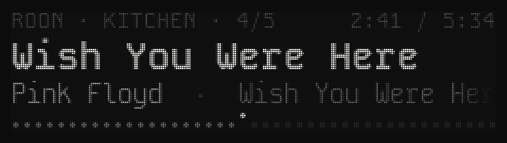
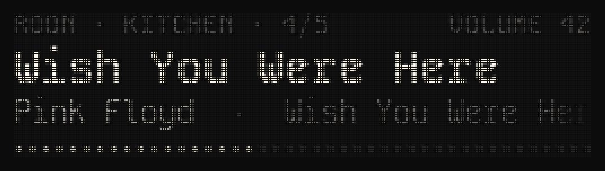
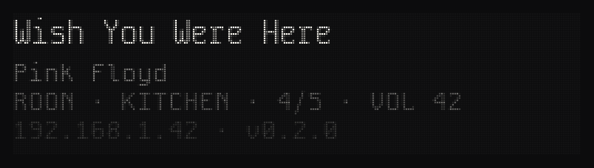
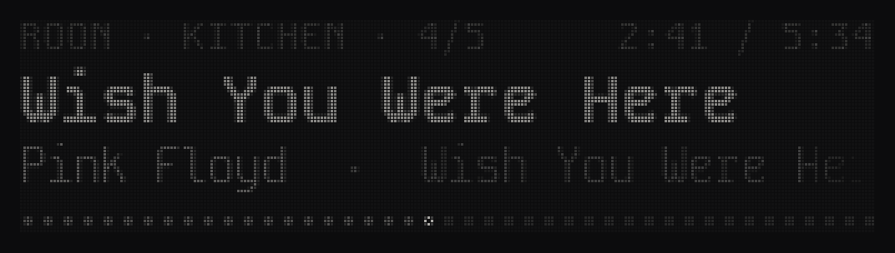
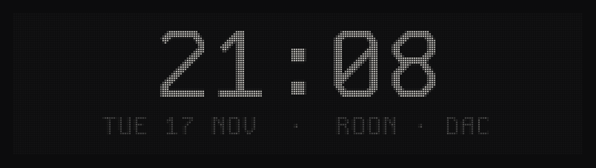
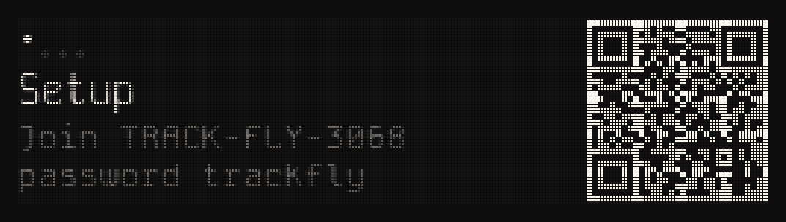

# Track Fly OLED



Firmware that turns an **ESP32-C3 SuperMini** and a **3.12" 256×64 SSD1322 OLED** into a now-playing display for your Mac. It shows what plays and a clock when nothing does. An optional four-key membrane pad gives you play/pause, skip, volume, zone and brightness; everything else lives on its own web page.

It reads the feed of **[Track Fly](https://trackfly.stream)**, a free macOS menu bar app that turns what is playing in Apple Music, Spotify, Roon and Plex into one JSON feed on your local network. You need Track Fly running on a Mac on the same network.

**Website and downloads: [trackfly.stream](https://trackfly.stream)** · Ready-made firmware: [trackfly.stream/firmware/oled](https://trackfly.stream/firmware/oled/) · The touch display version: [track-fly-waveshare](https://github.com/cryptooth/track-fly-waveshare)

| Volume (keypad) | Track details (keypad) |
|---|---|
|  |  |

| Paused | Nothing playing | First setup |
|---|---|---|
|  |  |  |

The pictures are rendered by the firmware's own drawing code (`tools/preview.sh`), pixel for pixel.

## What it does

- **Now playing in 16 shades of grey:** title, artist and album in Kode Mono (accented letters included), with the source, Roon zone or player, place in the album or playlist, and elapsed / total time. Long lines glide with soft edges.
- **The dot row:** 43 dots for progress. Playing, the current dot lifts out of the row; paused, it sits back in as a ring; a radio stream has a lifted dot drifting along.
- **A clock when nothing plays,** with the date and what it follows, or a dark screen if you prefer.
- **Follows a room:** pick a Roon zone or a player on its web page, or let it show whatever plays.
- **Night mode:** dim right down, or stay dark unless music plays, between two times.
- **Burn-in care:** the picture moves by a pixel every few minutes.
- **Finds the Mac by itself:** if the Mac's address changes, it looks for Track Fly on the network (`_trackfly._tcp`).
- **Updates itself:** it checks [trackfly.stream/firmware/oled](https://trackfly.stream/firmware/oled/) once a day and installs a newer version while nothing plays (SHA-256 checked, can be turned off). Track Fly 1.8+ also lists it under Settings › Displays.
- **Optional keypad:** previous, play/pause, next and track details; hold for volume, the next Roon zone and brightness.
- **Set up from your phone** with a QR code. No app, no cloud, no account.

## Hardware

- ESP32-C3 SuperMini (USB-C). Other ESP32-C3 boards work too; change the pins in `oled.ino`.
- 3.12" 256×64 OLED with an SSD1322 driver (the common blue-board module).
- Optional: a 1×4 membrane keypad.
- Optional: the SuperMini's expansion board with a battery socket and charger.

### Wiring

The module's resistors choose the bus. With **R19 and R21 fitted** it is in 4-wire SPI mode (the usual setting for SPI), which needs the D/C line:

| OLED | ESP32-C3 |
|---|---|
| GND (VSS) | GND |
| VCC | 3V3 |
| CLK (SCLK / D0) | GPIO4 |
| DIN (SDIN / D1) | GPIO6 |
| D/C | GPIO5 |
| RES | GPIO2 |
| CS | GPIO7 |

Leave D2–D7 unconnected. With **R19 and R20** fitted the module is in 3-wire SPI mode (no D/C): set `OLED_DC` to `-1` in `oled.ino` and leave D/C unconnected. Never tie D/C to GND while the firmware drives it.

### Keypad (optional)

A 1×4 membrane keypad: the common wire to GND, keys 1–4 to GPIO0, GPIO1, GPIO10 and GPIO20 (the firmware turns on the internal pull-ups). Key 3 is also read on GPIO3, but keep GPIO3 free if you plan to measure a battery there.

| Key | Short press | Long press (0.6 s) |
|---|---|---|
| 1 | previous track | volume down (keeps going while held) |
| 2 | play / pause | follow the next Roon zone (Auto, then each zone) |
| 3 | next track | volume up (keeps going while held) |
| 4 | track details for 7 s (album, source, zone, volume, address) | brightness step; after Max the screen turns off |

Hold **1 + 4** for 3 s to open WiFi setup; hold **2 + 3** for 1 s to show the clock instead of the track (again to go back). On a dark screen the first press only lights it. While the volume changes, the dot row shows the level. Volume works for Roon, Apple Music and Spotify.

## Install

The easiest way is a ready-made image from [trackfly.stream/firmware/oled](https://trackfly.stream/firmware/oled/):

- **First install over USB:** write `trackfly_oled-<version>-full-usb.bin` at offset `0x0`, for example with
  `esptool.py --chip esp32c3 write_flash 0x0 trackfly_oled-<version>-full-usb.bin`
- **Later versions:** it installs them by itself, or upload `trackfly_oled-<version>.bin` on the display's page (`http://track-fly-xxxx.local`, Firmware). Only ESP32-C3 images are accepted.

Or build it yourself (below).

## First setup

1. Power on. The screen shows the network `TRACK-FLY-XXXX` (password `trackfly`; XXXX is the end of the MAC address) and a QR code for joining it.
2. Scan the QR code with your phone, or join that network yourself. The setup page opens (otherwise go to `192.168.4.1`).
3. Pick your home network, type its password, check the Track Fly address, and press Save.
4. After it connects, its settings page is at `http://track-fly-xxxx.local` (same 4 characters).

Settings: Track Fly address, what to follow, brightness, scroll speed, what to show, upside down, night mode, time zone, name, a web password, and firmware.

## Build

The sketch is in [`trackfly_oled/`](trackfly_oled). With [arduino-cli](https://arduino.github.io/arduino-cli/) and the ESP32 core 3.x installed:

```bash
cd trackfly_oled
./build_firmware.sh          # firmware/trackfly_oled-<ver>.bin (web update) and -full-usb.bin
./build_firmware.sh upload   # also flashes over USB (PORT=/dev/cu.usbmodemXXXX to pick one)
tools/preview.sh             # renders every screen to tools/preview/*.png on your computer
python3 fonts/gen_fonts.py   # regenerates fonts.h from the TTFs (needs npx lv_font_conv)
```

It builds for `esp32:esp32:esp32c3` with the `min_spiffs` partition scheme (two 1.9 MB app slots, so updates work). No libraries to install: ArduinoJson and the QR code generator are included. The scripts are written for macOS; on Linux, change the esptool path.

How it is put together: `oled.ino` drives the SSD1322 (whole frame per push, unchanged frames skipped), `gfx.cpp` is a 4-bit frame buffer with antialiased text, `screens.cpp` holds the layouts (plain C++, so the preview tool can build it), `feed.ino` reads Track Fly, `net.ino` does WiFi, the setup portal and the web page, `update.ino` the self-update, `ui.ino` decides which screen to show.

## How it talks to Track Fly

The display polls `http://<mac>:8765/now` and gets JSON like this:

```json
{ "state": "playing", "source": "roon", "zone": "Living Room",
  "title": "Wish You Were Here", "artist": "Pink Floyd", "album": "Wish You Were Here",
  "position": 61.2, "duration": 334.7, "track_number": 4, "track_count": 5 }
```

The full field list is on [trackfly.stream](https://trackfly.stream/#fields). The same feed works for Home Assistant, an LED matrix, e-ink, a stream overlay or a script.

## Credits

- [ArduinoJson](https://arduinojson.org) (MIT, included as a single header) for the feed.
- QR codes: [QRCode](https://github.com/ricmoo/QRCode) by Richard Moore (MIT, included as `tf_qrcode.*`).
- SSD1322 set-up sequence after [U8g2](https://github.com/olikraus/u8g2) by Oliver Kraus.
- Fonts: [Kode Mono](https://github.com/isaozler/kode-mono) (SIL Open Font License), converted with lv_font_conv.

## License

MIT, see [LICENSE](LICENSE). ArduinoJson and QRCode keep their own MIT licenses, and the Kode Mono fonts are under the SIL Open Font License.

Not affiliated with Apple, Spotify, Roon Labs or Plex.
